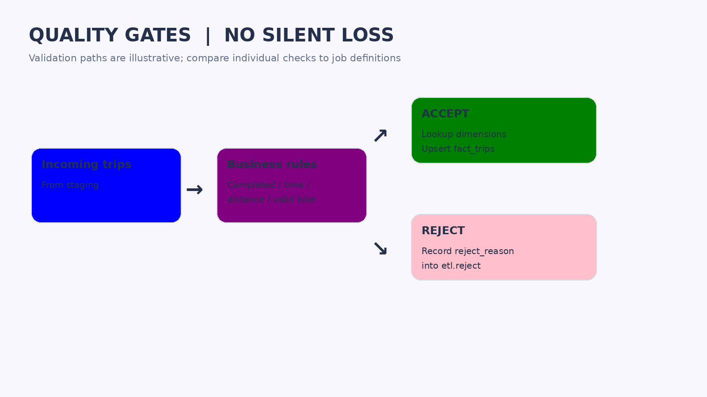
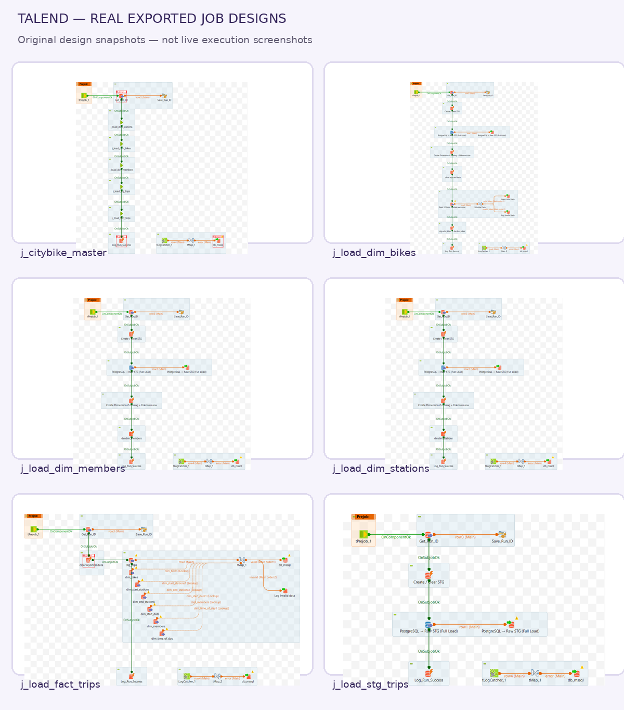

# 🚲 CityBike Data Warehouse — From Bike Rides to Business Insights

> **Portfolio case study** | PostgreSQL · Talend Studio 8 · Microsoft SQL Server · Dimensional Modeling · SQL Analytics

📚 **[Full project walkthrough on Notion](https://app.notion.com/p/4181c4bc255080619a63cf6d098eefac)** · 🧪 **[Validation evidence](docs/EVIDENCE_AND_VERIFICATION.md)** · 🗺️ **[Editable architecture diagram](assets/diagrams/architecture_editable.drawio)**

## 👋 The business story
CityBike's operational database records stations, bikes, members and trips. Management needs a repeatable, clear way to analyze usage, revenue, fleet adoption and historical membership behavior. This project follows a **batch ETL** approach: ingest four PostgreSQL source entities with Talend, stage them in SQL Server, model a trip-grain star schema and answer seven management questions.

## 🧩 The solution

| Layer | Technology | Purpose |
|---|---|---|
| Source | PostgreSQL `ops` | Stations, bikes, members and trips |
| Orchestration and ETL | Talend Studio 8 | Extraction, validation, loading |
| Landing | SQL Server `CityBikeDW.stg` | Source snapshots |
| Warehouse | SQL Server `CityBikeDW.dw` | Dimensions, fact trips, SCD Type 2 |
| Audit | SQL Server `CityBikeDW.etl` | Rejections and run history |
| Consumers | SQL queries | Seven management questions |

## 🌟 Star schema

**Grain:** one accepted, completed trip per fact row. `dw.fact_trips` contains date/hour, bike, member, and start/end-station keys plus trip measures. The `dw.dim_members` plan uses SCD Type 2 for history; other profile attributes use Type 1 update behavior.

## 🛡️ Quality and historical correctness

- Cancelled rides are excluded; invalid distance, end-before-start and unknown bike are rejected.
- Unknown member or end-station references map to Unknown surrogate 0, as required by the brief.
- SCD Type 2 preserves a member's earlier plan; trip `start_ts` resolves the appropriate historical version.
- `etl.reject` and `etl.run_log` make row-level errors and executions traceable.

## 🧮 Observed runtime baseline (SSMS, November 14, 2026)

The project owner ran a read-only SQL Server row-count query and shared its SSMS results screenshot. The implementation includes custom cases, so observed values are documented separately from the assignment benchmarks.

| Table | Observed rows |
|---|---:|
| `stg.stg_stations` | 25 |
| `stg.stg_bikes` | 120 |
| `stg.stg_members` | 510 |
| `stg.stg_trips` | 20,000 |
| `dw.fact_trips` | 19,582 |

These counts describe the owner's customized dataset. Separate SSMS evidence also supports the selected fact/dimension integrity checks described below.

### Original brief benchmarks (reference only)

The original brief targets 19,577 accepted fact trips at first load and 19,877
after its change cycle. Those benchmarks are **not reproduced SQL results** for
the customized implementation. The brief also lists an initial revenue target
of 60,184.80; this figure has not been independently verified here.

## 📊 Business questions — SQL and observed results

The warehouse answers seven management questions using **[read-only SQL queries](sql/analytics/business_questions.sql)**. The project owner ran Q0–Q7 in SSMS; the following are observed values from the supplied results screenshot, not demo numbers.

| Question | Business question | Evidence from SQL Server |
|---|---|---|
| Q0 | How many completed fact trips and how much revenue? | **19,582 trips**, **60,195.90** total fee |
| Q1 | What are monthly trips and revenue? | Monthly breakdown produced; see [Notion analysis](https://app.notion.com/p/4181c4bc25508176a6cad113ab7fcc45) for transcribed visible rows |
| Q2 | How does trip duration/distance vary by membership plan? | `pay_go`: **9,425 trips**, average **31.96 min**, **7.78 km** |
| Q3 | Which start stations have the most trips? | **Station 01 Riverside — 3,914 trips** |
| Q4 | What proportion of trips use electric bikes? | Query reported **33.33%** electric share |
| Q5 | Which departure district generated the most revenue? | **Riverside — 18,882.90** |
| Q6 | How did member activity change before and after a membership plan change? | Query returned **no rows** in the supplied run; no before/after conclusion is claimed |
| Q7 | How do trips vary by time of day? | **Morning — 7,894 trips (40.31%)** in visible results |

**Evidence boundary:** Some SQL result grids were cropped (notably Q1 and Q7). No missing values are inferred. See [Business Analysis & Presentation in Notion](https://app.notion.com/p/4181c4bc25508176a6cad113ab7fcc45) for the detailed result tables and evidence notes.

## 🛠️ Reproducing the learning project

1. Run `sql/source/citybike_source_pg.sql` in a fresh PostgreSQL `citybike_src` database.
2. Run `sql/setup/citybike_dw_skeleton_mssql.sql` in SQL Server and optionally `sql/setup/dim_date_time_helper_mssql.sql`.
3. Review the Talend job designs and screenshots under [`talend/`](talend/) and [`assets/talend-screenshots/`](assets/talend-screenshots/). Configure connections and contexts locally. **Do not reuse any credentials found in an exported Talend project.**
4. Configure connection contexts using secrets outside version control. Run the master ETL and inspect the results using `sql/validation/acceptance_checks.sql`. **Review the script’s original-brief expected values before treating PASS/FAIL output as authoritative for custom cases.**
5. Apply `sql/source/citybike_changes_pg.sql` **once on the clean baseline**; the membership-update script is not idempotent. Rerun ETL, and revalidate historical relationships.

## 🔍 Evidence and limitations

- Original Talend job-design screenshots extracted from the user-provided Talend Studio export are included below. Additional actual Studio screenshots are in [`assets/talend-user-screenshots/`](assets/talend-user-screenshots/), with an annotated [`Evidence Book (PDF)`](docs/CityBike_Talend_Evidence_Book.pdf). These show the **design canvas**, not proof of successful execution.
- Explanatory architecture, star-schema, SCD2 and quality-gate diagrams are representative illustrations.
- `docs/EVIDENCE_AND_VERIFICATION.md` documents what was independently verified from source artifacts and what still requires a real database.
- The portfolio-generation environment did not independently run PostgreSQL, SQL Server or Talend. The owner separately executed and supplied SSMS row-count results, documented above.
- Source/target count targets and analytics benchmarks are explicitly attributed to the brief.
- Files provided by the course are identified as starter material, not represented as independently authored student code.
- This GitHub repository is published. Redistribution rights for course assets and the final sanitized Talend archive still require independent review. The observed SSMS row counts above are actual reported outputs; other runtime claims require separate evidence.

## 🗺️ Explore

- **[Complete project documentation on Notion](https://app.notion.com/p/4181c4bc255080619a63cf6d098eefac)** — the 11-phase learning journey, diagrams, design decisions and evidence status. Notion and GitHub are cross-linked manually; there is no automatic synchronization.

- [`docs/`](docs/) — requirements, mapping, traceability, operations and testing notes.
- [`sql/`](sql/) — assignment seed/setup, validation and analytics scripts.
- [`assets/diagrams/architecture_editable.drawio`](assets/diagrams/architecture_editable.drawio) — editable architecture flow.
- [`presentation/CityBike_Portfolio_Showcase.pptx`](presentation/CityBike_Portfolio_Showcase.pptx) — five-minute interview presentation.

## 📚 Full project documentation and diagrams

The **[Notion Project Hub](https://app.notion.com/p/4181c4bc255080619a63cf6d098eefac)** contains the full 11-phase walkthrough and the following **six standalone engineering references**:

| Reference | What it covers | View |
|---|---|---|
| Data Flow Diagram | PostgreSQL → Talend → SQL Server stages, warehouse, analytics | [Notion](https://app.notion.com/p/4181c4bc255081b7bfe5d5c2b1c0b1f3) |
| Data Integration Diagram | Table-by-table source, staging and warehouse lineage | [Notion](https://app.notion.com/p/4181c4bc2550817dbb2ec1c8e3564572) |
| ETL Flow Diagram | Master job, child job sequence and audit paths | [Notion](https://app.notion.com/p/4181c4bc2550819a8797cd487b3fe08d) |
| Data Catalog | Logical schema, fields, types, grains and dimensions | [Notion](https://app.notion.com/p/4181c4bc255081d2b88deecb7113a761) |
| Source-to-Target Mapping | 113 mappings across source, stage, dimensions, fact and audit | [Notion](https://app.notion.com/p/4181c4bc2550813ea1f5fb4072ca0c9c) |
| Naming Conventions | Schema, table, business key and surrogate key naming | [Notion](https://app.notion.com/p/4181c4bc25508181bbf5d62a1d425cd5) |

### Data profiling and validation

- [Original Excel Quality Register: 32 questions (questions only)](https://app.notion.com/p/4181c4bc25508189b896e51d9e10715a)
- [Expanded PostgreSQL profiling and quality checks](https://app.notion.com/p/4181c4bc2550810197a8eba8d91e98ae) — 40 exploratory queries
- [Testing & Historical Validation](https://app.notion.com/p/4181c4bc255081cf8de3d6cd78c13afd) — observed SCD2 lookup and foreign-key checks
- [Data Quality & Operations](https://app.notion.com/p/4181c4bc25508199ba06d3f6da41482f) — batch run evidence and checks
- Existing SQL analytics: [`sql/analytics/business_questions.sql`](sql/analytics/business_questions.sql)

### Companion files for the repository

The following additions have been prepared separately for GitHub. **Upload them to the stated locations before replacing these paths with clickable local links:**

- `assets/diagrams/`: `01_data_flow.drawio`, `02_data_integration.drawio`, `03_etl_flow.drawio`
- `docs/`: `01_data_flow.md`, `02_data_integration.md`, `03_etl_flow.md`, `04_data_catalog.md`, `05_source_to_target_mapping.md`, `06_naming_conventions.md`, `source_to_target_mapping_FULL.csv`, `Quality_Register_and_Exploration_Question_Bank.md`, `Quality_Register_Query_Index.csv`
- `sql/source/`: `CityBike_PostgreSQL_Profiling_ALL.sql`
- `sql/validation/`: `07_live_physical_schema_export.sql`, `01_SCD2_Validation.sql`, `02_Data_Quality_Validation.sql`, `03_Run_Logs_Evidence.sql`

**Mapping qualification:** The source-to-target reference documents all fields visible in the project artifacts. Live physical SQL Server metadata is needed to independently confirm final column definitions and constraints.

## 🔀 Real Talend Job Designs — exported project artifacts

The following image is a contact sheet from **six actual Talend `.screenshot` XML/Base64 files** included in the uploaded project export (not an invented UI mockup).

See the individual full-size images in [`assets/talend-screenshots/`](assets/talend-screenshots/) and the Talend project documentation in [`talend/README.md`](talend/README.md).

**Note:** The screenshot of the master job contains red error indicators on components; these screenshots demonstrate layout, not that the job passed runtime tests.

## 🔐 Repository security and evidence audit

- **Public-release check needed:** an original `talend/Job Designs/` tree and `talend/Job Designs.zip` have appeared in the public repository. Inspect all connection context/metadata values and Git history, remove any exposed secrets from history, and rotate real credentials if they were exposed. A `.gitignore` change alone does not remove past commits.
- The original course materials should retain attribution, and redistribution permissions should be checked before further promotion.
- Talend screenshots demonstrate job designs. User-provided SSMS screenshots demonstrate the *specific* recorded results above, not a new Talend run executed by this documentation tool.
- [Evidence audit](docs/EVIDENCE_AND_VERIFICATION.md) · [Machine-readable audit](docs/artifact_verification.json).
