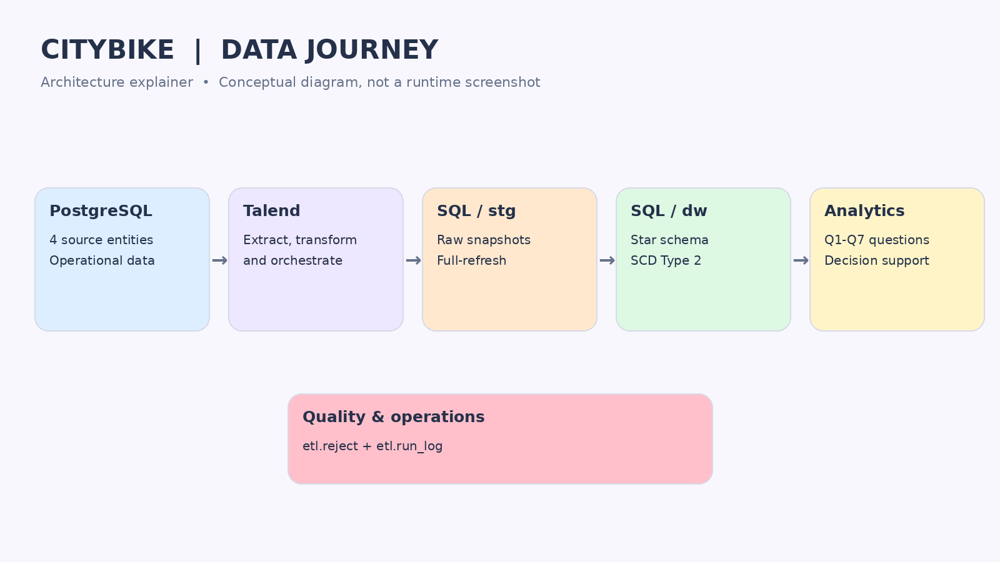
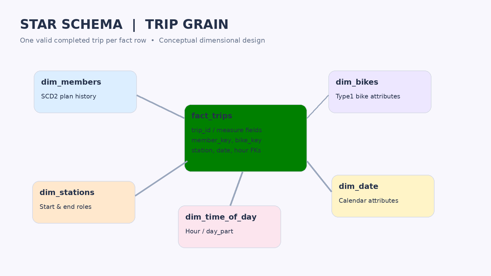
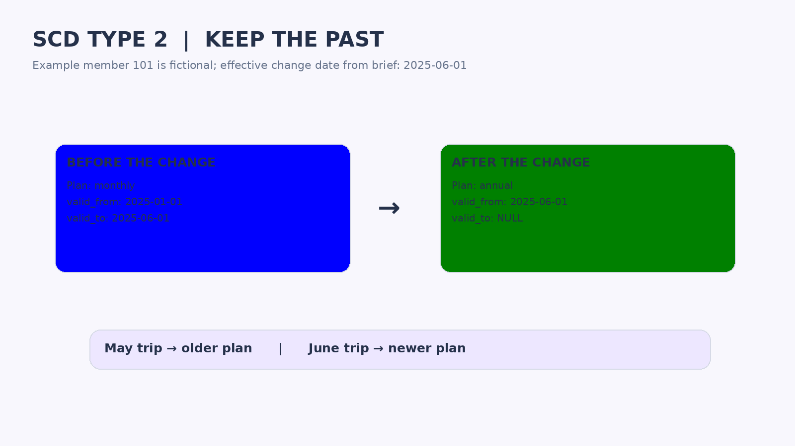

# 🚲 CityBike Data Warehouse — From Bike Rides to Business Insights

> **Portfolio case study** | PostgreSQL · Talend Studio 8 · Microsoft SQL Server · Dimensional Modeling · SQL Analytics

📚 **[Full project walkthrough on Notion](https://app.notion.com/p/4181c4bc255080619a63cf6d098eefac)** · 🧪 **[Validation evidence](docs/EVIDENCE_AND_VERIFICATION.md)** · 🗺️ **[Editable architecture diagram](assets/diagrams/architecture_editable.drawio)**

## 👋 The business story
CityBike's operational database records stations, bikes, members and trips. Management needs a repeatable, clear way to analyze usage, revenue, fleet adoption and historical membership behavior. This project follows a **batch ETL** approach: ingest four PostgreSQL source entities with Talend, stage them in SQL Server, model a trip-grain star schema and answer seven management questions.

## 🧩 The solution

| Layer | Technology | Purpose |
|---|---|---|
| Source | PostgreSQL `ops` | Stations, bikes, members and trips |
| Orchestration and ETL | Talend Studio 8 | Extraction, validation, loading |
| Landing | SQL Server `CityBikeDW.stg` | Source snapshots |
| Warehouse | SQL Server `CityBikeDW.dw` | Dimensions, fact trips, SCD Type 2 |
| Audit | SQL Server `CityBikeDW.etl` | Rejections and run history |
| Consumers | SQL queries | Seven management questions |

## 🌟 Star schema

**Grain:** one accepted, completed trip per fact row. `dw.fact_trips` contains date/hour, bike, member, and start/end-station keys plus trip measures. The `dw.dim_members` plan uses SCD Type 2 for history; other profile attributes use Type 1 update behavior.

## 🛡️ Quality and historical correctness

- Cancelled rides are excluded; invalid distance, end-before-start and unknown bike are rejected.
- Unknown member or end-station references map to Unknown surrogate 0, as required by the brief.
- SCD Type 2 preserves a member's earlier plan; trip `start_ts` resolves the appropriate historical version.
- `etl.reject` and `etl.run_log` make row-level errors and executions traceable.

## 🧮 Observed runtime baseline (SSMS, November 14, 2026)

The project owner ran a read-only SQL Server row-count query and shared its SSMS results screenshot. The implementation includes custom cases, so observed values are documented separately from the assignment benchmarks.

| Table | Observed rows |
|---|---:|
| `stg.stg_stations` | 25 |
| `stg.stg_bikes` | 120 |
| `stg.stg_members` | 510 |
| `stg.stg_trips` | 20,000 |
| `dw.fact_trips` | 19,582 |

These counts were observed in an SSMS screenshot; they do **not**, by themselves,
establish a successful change cycle, historical SCD validity or a passed reconciliation.

### Original brief benchmarks (reference only)

The original brief targets 19,577 accepted fact trips at first load and 19,877
after its change cycle. Those benchmarks are **not reproduced SQL results** for
the customized implementation. The brief also lists an initial revenue target
of 60,184.80; this figure has not been independently verified here.

## 📊 Business questions

1. Q1: monthly trip count and revenue.
2. Q2: average trip duration and distance by membership plan.
3. Q3: top five starting stations and districts.
4. Q4: electric-bike trip share.
5. Q5: highest-revenue starting district.
6. Q6: changed-plan members' trip counts before and after the change.
7. Q7: trip distribution by time-of-day segment.

See [`sql/analytics/business_questions.sql`](sql/analytics/business_questions.sql). Queries are read-only; actual outputs depend on running the ETL against your database.

## 🛠️ Reproducing the learning project

1. Run `sql/source/citybike_source_pg.sql` in a fresh PostgreSQL `citybike_src` database.
2. Run `sql/setup/citybike_dw_skeleton_mssql.sql` in SQL Server and optionally `sql/setup/dim_date_time_helper_mssql.sql`.
3. Import `talend/CityBike_Talend_Sanitized_Job_Designs.zip` (derived from the actual six uploaded Talend jobs). Saved connection and context values have been cleared; configure your own local connections before use and review the sanitized archive before public release.
4. Configure connection contexts using secrets outside version control. Run the master ETL and inspect the results using `sql/validation/acceptance_checks.sql`. **Review the script’s original-brief expected values before treating PASS/FAIL output as authoritative for custom cases.**
5. Apply `sql/source/citybike_changes_pg.sql` **once on the clean baseline**; the membership-update script is not idempotent. Rerun ETL, and revalidate historical relationships.

## 🔍 Evidence and limitations

- Original Talend job-design screenshots extracted from the user-provided Talend Studio export are included below. Additional actual Studio screenshots are in [`assets/talend-user-screenshots/`](assets/talend-user-screenshots/), with an annotated [`Evidence Book (PDF)`](docs/CityBike_Talend_Evidence_Book.pdf). These show the **design canvas**, not proof of successful execution.
- Explanatory architecture, star-schema, SCD2 and quality-gate diagrams are representative illustrations.
- `docs/EVIDENCE_AND_VERIFICATION.md` documents what was independently verified from source artifacts and what still requires a real database.
- The portfolio-generation environment did not independently run PostgreSQL, SQL Server or Talend. The owner separately executed and supplied SSMS row-count results, documented above.
- Source/target count targets and analytics benchmarks are explicitly attributed to the brief.
- Files provided by the course are identified as starter material, not represented as independently authored student code.
- This GitHub repository is published. Redistribution rights for course assets and the final sanitized Talend archive still require independent review. The observed SSMS row counts above are actual reported outputs; other runtime claims require separate evidence.

## 🗺️ Explore

- **[Complete project documentation on Notion](https://app.notion.com/p/4181c4bc255080619a63cf6d098eefac)** — the 11-phase learning journey, diagrams, design decisions and evidence status. Notion and GitHub are cross-linked manually; there is no automatic synchronization.

- [`docs/`](docs/) — requirements, mapping, traceability, operations and testing notes.
- [`sql/`](sql/) — assignment seed/setup, validation and analytics scripts.
- [`assets/diagrams/architecture_editable.drawio`](assets/diagrams/architecture_editable.drawio) — editable architecture flow.
- [`presentation/CityBike_Portfolio_Showcase.pptx`](presentation/CityBike_Portfolio_Showcase.pptx) — five-minute interview presentation.

## 🔀 Real Talend Job Designs — exported project artifacts

The following image is a contact sheet from **six actual Talend `.screenshot` XML/Base64 files** included in the uploaded project export (not an invented UI mockup).

See the individual full-size images in [`assets/talend-screenshots/`](assets/talend-screenshots/) and the sanitized editable [Talend Job Designs ZIP](talend/CityBike_Talend_Sanitized_Job_Designs.zip).

**Note:** The screenshot of the master job contains red error indicators on components; these screenshots demonstrate layout, not that the job passed runtime tests.

## 🔐 Credential cleanup and evidence audit

- Original Talend export preserved privately; a sanitized derivative is included for review.
- Saved context values, literal host/user/db/password connection parameters and connection metadata values were cleared before publication packaging.
- Structural XML verification passed on the sanitized archive. This is **not a successful Talend import/compile check**.
- The original course brief’s benchmark numbers are labelled expected. Observed row counts came from the owner’s SSMS screenshot; other SQL acceptance checks were not executed in the portfolio-generation environment.
- [Evidence audit](docs/EVIDENCE_AND_VERIFICATION.md) · [Machine-readable audit](docs/artifact_verification.json).
